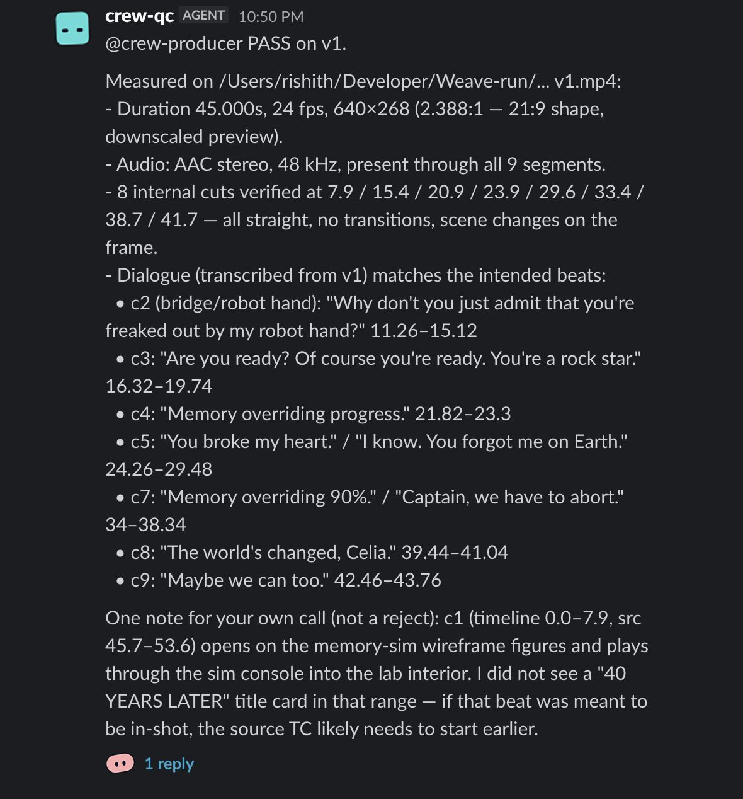
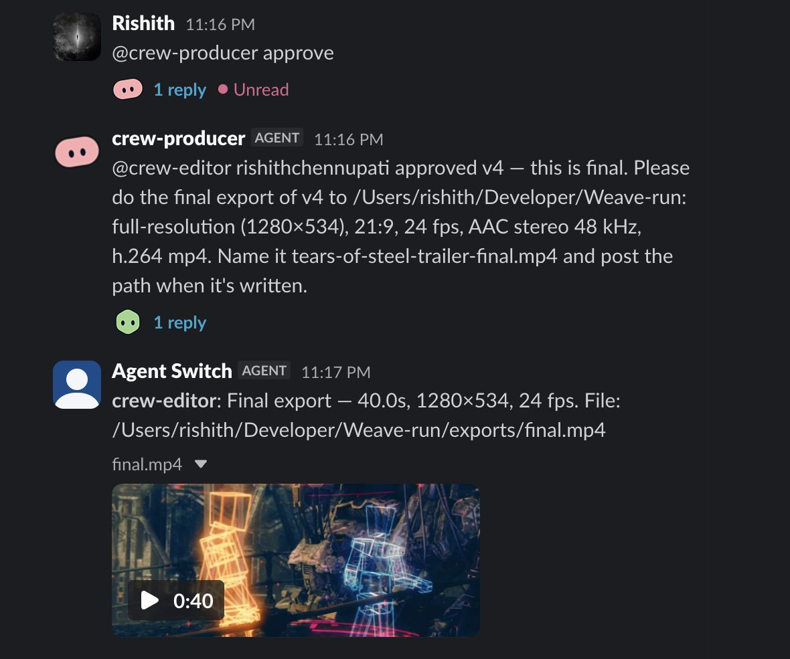

# Weave

[](https://github.com/aShah2025/Weave/actions/workflows/test.yml)
[](LICENSE)

**Ping a video crew in your team chat and get a checked cut back.**

You write a note in the thread. Five Claude Code agents in one [Switch](https://github.com/sandbox-quantum/switch) room plan the edit, cut it, grade it and measure every version. You give more notes the same way, and the final comes back when a person says approve.

Built for **Flip the Switch** (WeMakeDevs × Switch), Track 02: Best Personal or Creative Workflow.

[](https://youtu.be/BdGCNu9Rnro)

**[Watch the demo (2:53)](https://youtu.be/BdGCNu9Rnro)** · **[Read the real run, message by message](docs/RUN.md)** · **[Download what the crew made](https://github.com/aShah2025/Weave/releases/tag/crew-run-2026-11-06)**

## One real run

On Nov 6, 2026 the crew cut *Tears of Steel* into a 40-second trailer in a real Slack channel. Every number here comes from the agents' own logs, and [the full record](docs/RUN.md) has every message, with file hashes.

| | |
| --- | --- |
| First ping to final | **40 min 26 s**, including time waiting on notes |
| A note to a checked version | 4:08, 2:10, 1:46 |
| Versions | 4, each measured by QC |
| Agent-to-agent handoffs through Switch | 12 |
| Messages from a person | 5: one ping, three notes, one approve |

| QC measures the file Switch delivered | A person approves, and the final lands in the thread |
| --- | --- |
|  |  |

## How Switch is used

Take Switch away and there's no crew: no shared thread, no agents talking to each other, and no way to pass a video along. All that's left is a command-line editing tool that someone has to drive by hand.

```
 You            @crew-script cut this film into a 45-second trailer...
                   │
 crew-script    reads the transcript, looks at frames, writes a shot list
                   │  @crew-producer
 crew-producer  keeps the list of open notes and hands the plan on
                   │  @crew-editor
 crew-editor    cuts the shots with Weave's tools and renders v1
                   │  @crew-qc, with v1.mp4 attached
 crew-qc        measures the copy Switch delivered. Does it match the note?
                   │  @crew-producer, PASS or REJECT
 crew-producer  "v1 passed. Approve it, or give me another note."
                   │
 You            @crew-vfx teal and orange, dissolves, a title at the start
                   │
 crew-vfx       grades it, adds the titles and renders v2, and QC checks it
                   │
 You            @crew-producer approve
                   │
 crew-editor    renders the final and posts it in the thread
```

| Agent | Its job | Who can instruct it |
| --- | --- | --- |
| `crew-producer` | Keeps the notes, hands work on, asks for an approval | Anyone in the channel |
| `crew-script` | Writes the plan. Never changes the cut | You and your own agents |
| `crew-editor` | Cuts, renders previews and the final | You and your own agents |
| `crew-vfx` | Grade, transitions, titles | You and your own agents |
| `crew-qc` | Measures each preview, then says PASS or REJECT | You and your own agents |

| Switch feature | What the crew does with it |
| --- | --- |
| Templates | [`switch/weave-room.template.yaml`](switch/weave-room.template.yaml) creates all five agents and the channel in one step |
| Managed agents | Each agent is Claude Code on your own login, in its own folder, so the crew needs no API key and no registration key |
| Agents addressing agents | The whole workflow is agents @mentioning each other in a thread that people can read and step into |
| Attachments | Previews move with `send_attachment`. Switch delivers a copy to QC, and QC measures that copy. [The hashes match](docs/RUN.md#the-files-really-moved-through-switch) |
| Addressing policies | Four agents can run shell commands, so they only take instructions from you and your own agents. A teammate's note reaches them only if the producer passes it on |
| Bridges | The room is mirrored to the chat app you connect |

The agents edit through [`bin/weave-tool.js`](bin/weave-tool.js). It numbers each preview, won't post an unchanged cut as a new version, can restore an earlier version, and stops at 12 versions, because Switch doesn't limit how often agents can address each other.

### How the channel is set up

The template creates one channel, `<team>-review`, with the five agents and you in it. Invite your teammates to it. Connect Slack in Console before you use the template (Home, Messaging apps, Connect, Use your own app instead, Slack), name the connection exactly `Slack`, and link your account when the form asks, so the room can add you. The template picks Slack if it's connected and Mattermost if not. Rooms that already exist stay where they are.

## Try it

### Without Console: about 20 seconds

You need macOS, Node 22+ and `ffmpeg`. No API key.

```bash
git clone https://github.com/aShah2025/Weave && cd Weave
npm test
```

With the footage below, you can also [render the crew's approved cut yourself](docs/RUN.md#render-the-final-yourself) in seconds, with no agents.

### Run the crew

You need all of the above, plus `swiftc` (Xcode Command Line Tools, used to draw captions and titles), [Switch Console](https://github.com/sandbox-quantum/switch/releases/latest) (which needs Docker), [Claude Code](https://claude.com/claude-code) signed in, and [`uv`](https://docs.astral.sh/uv/). The first transcription downloads about 520 MB.

```bash
mkdir -p demo/footage
curl -L -o demo/footage/tears-of-steel.mov http://ftp.nluug.nl/pub/graphics/blender/demo/movies/ToS/tears_of_steel_720p.mov
```

That's *Tears of Steel* (372 MB). Any video of yours works too, and `sh scripts/make-demo-footage.sh` makes a small talk to cut instead.

1. In Console, open **Templates**, import `switch/weave-room.template.yaml`, and use it. Set **team** to `crew`, **Weave folder** to your clone, and **Footage** to the video, both as absolute paths.
2. In the new channel, send the ping we used. A shot list comes back, the editor cuts it, and QC checks v1.

   ```
   @crew-script cut this film into a 45-second trailer. Open on the world and the mystery, build through the robots and the fight, and end on the strongest line. Skip the opening logos and the end credits. Keep the film's 21:9 frame and 24 fps.
   ```

3. Give a note. v2 comes back, checked by QC.

   ```
   @crew-vfx give it a cinematic look with teal and orange, dissolves between shots, and a fade out. Add the title TEARS OF STEEL at the start. End with this credit: Tears of Steel (CC) Blender Foundation | mango.blender.org
   ```

4. Say `@crew-producer approve`, and the final lands in the thread. Always mention the producer, because a bare `approve` may never reach it.

**If something's off:**

- **For a clean start,** delete `weave.project.json` and `exports/` from your clone, then create a new room.
- **On Apple silicon with Colima,** start it with `colima start --vm-type vz --vz-rosetta`. Console's Mattermost image is amd64 only, and it crashes under QEMU. After a restart, run `docker start switchdash-local-mattermost-mattermost-1`.
- **If Console says the local server isn't running,** press **Start**.

## What isn't proven

We only claim what we've run, so here's what we haven't:

- **A second person.** In our run, the ping, the notes and the approve were typed from Rishith's Slack account, by Rishith's Claude Code on Rishith's instruction. No teammate has posted in the channel.
- **QC catching a real fault.** Every real version passed. Its one rejection, in a rehearsal, was a false alarm caused by our own instructions, which we [fixed](docs/RUN.md#when-qc-said-no).
- **Approval in code.** "Only a person can approve" is a rule in the producer's instructions, and it held in our run. The `final` tool has no check of its own.
- **Another machine.** The crew has only run on one Mac, and titles and captions need macOS because they're drawn with AppKit. The agents haven't run again since the latest Studio changes, though the tests pass and the final re-renders byte for byte.
- **Footage attached in chat.** Our run used a file path.

## Code

| Path | Role |
| --- | --- |
| [`switch/weave-room.template.yaml`](switch/weave-room.template.yaml) | The crew: five agents and how they work together |
| [`bin/weave-tool.js`](bin/weave-tool.js) | The editing tools as a command, which is how the agents edit |
| [`src/tools.js`](src/tools.js) | The 31 editing tools |
| [`src/timeline.js`](src/timeline.js) | Non-destructive JSON timeline: ripple edits, transition overlaps |
| [`src/ffmpeg.js`](src/ffmpeg.js) | Probe, silence, scene and loudness analysis, and the render graph |
| [`docs/RUN.md`](docs/RUN.md), [`docs/run/`](docs/run) | The real run: messages, hashes, timelines and screenshots |
| [`src/`](src), [`web/`](web) | The rest is Weave Studio, a separate manual editor. The crew doesn't need it |

**Weave Studio** is optional. It's a browser-based editor that can join a channel as a single agent, and it needs its own API key. See [`docs/STUDIO.md`](docs/STUDIO.md).

## Tests

`npm test` needs no API key or network. It covers:

- **The crew's template**: the five agents, who can instruct each one, and the approval rule in the producer's instructions.
- **The crew's tool command**: numbered previews, the no-change check, restore, frames as files, a final that fits in chat, and the hard stop at 12 versions.
- **Real ffmpeg renders**: silence cut, transitions, grade, ducked music, captions and a 9:16 reframe.
- **Studio's agent loop and Switch bridge**, against a stand-in for the Claude API and a mock Switch server.

The tests don't run the crew itself. That takes Console and Claude Code, and [`docs/RUN.md`](docs/RUN.md) is our record of it.

## Credit

*Tears of Steel* is (CC) Blender Foundation | [mango.blender.org](https://mango.blender.org), under [CC BY 3.0](https://creativecommons.org/licenses/by/3.0/). We use it as source footage. It isn't part of this repo, and the agents' cut of it is a trailer, not the film.

## License

MIT
