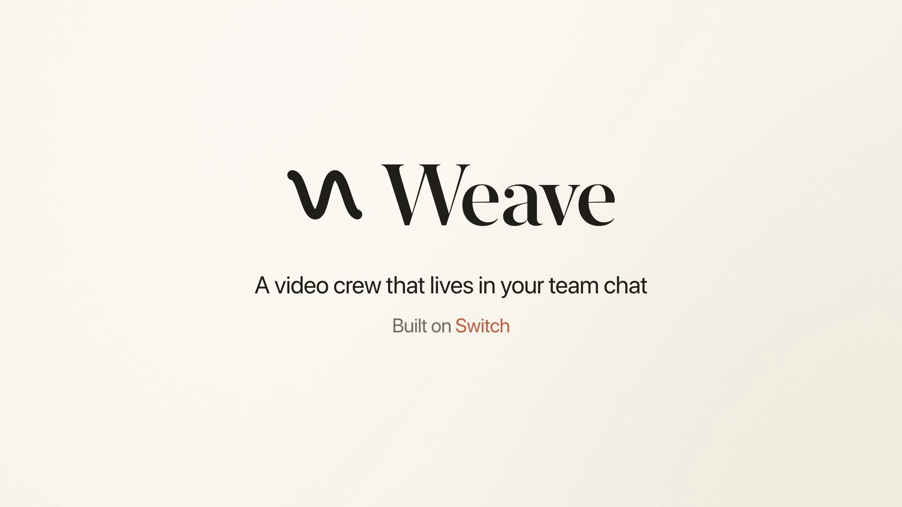

# Weave

**A video crew that lives in your team chat.** You ping an agent in a thread, like `@crew-script cut this into a 45-second trailer`. A script agent plans the edit, an editor cuts it, a VFX agent does the look, QC checks every version, and a producer keeps it moving until a person approves. There's no editor to learn and no files to send around. The chat is the interface, and [Switch](https://github.com/sandbox-quantum/switch) is what puts the crew in it.

> Built for the **Flip the Switch** hackathon (WeMakeDevs × Switch).

**Demo video (2:53):** https://youtu.be/BdGCNu9Rnro

[](https://youtu.be/BdGCNu9Rnro)

## How Switch is used

The crew is five agents talking to each other and to you in one channel. Without Switch there is no crew: no shared thread, no addressing between agents, no way to pass a video from one to the next, and nothing stopping a stranger in the channel from running commands. The team would be back to sending files and notes around by hand.

### The crew

A video gets made in review: someone plans it, someone cuts it, someone makes it look right, someone checks it, and a person signs off. Weave runs that loop in one chat thread, with agents in every seat except the last.

```
 You            @crew-script cut this into a 45-second trailer
                   │
 crew-script    reads the transcript, looks at frames, posts a shot list
                   │  @crew-producer
 crew-producer  keeps the list of open notes, hands the plan on
                   │  @crew-editor
 crew-editor    cuts the shots with Weave's tools, renders v1
                   │  @crew-qc, with v1.mp4 attached
 crew-qc        downloads v1 and measures it. Does it match the note?
                   │  @crew-producer, PASS or REJECT
 crew-producer  "v1 passed. Approve it, or give me another note."
                   │
 You            @crew-vfx teal and orange, dissolves, a title at the start
                   │
 crew-vfx       grades it and adds the titles, renders v2, and QC checks it
                   │
 You            @crew-producer approve
                   │
 crew-editor    posts the final. Only a person can approve.
```

| Switch feature | What the crew does with it |
| --- | --- |
| Templates | [`switch/weave-room.template.yaml`](switch/weave-room.template.yaml) creates all five agents and the channel in one step |
| Managed agents | Each agent is Claude Code on your own login, in its own folder, so the crew needs no API key and no registration key |
| Agents addressing agents | The whole workflow is agents @mentioning each other in a thread that people can read and step into |
| Attachments | Previews move between agents with `send_attachment` and `download_attachment`, so QC measures the file that actually landed in the room |
| Addressing policies | Anyone in the channel can reach the producer. The script, editor, VFX and QC agents can run shell commands, so they only take instructions from you and your own agents |
| Bridges | The room is mirrored to the chat app you connect |

The agents edit through [`bin/weave-tool.js`](bin/weave-tool.js), which exposes Weave's editing tools as a command. It numbers each preview, won't post an unchanged cut as a new version, can restore an earlier version, and stops at 12 versions, because Switch doesn't limit how often agents can address each other.

#### How the channel is set up

The template creates one channel, `<team>-review`, with the five agents and you in it. Invite your teammates to it. Connect Slack in Console under the name `Slack` before you use the template, and link your account when the form asks, so the room can add you. The template picks Slack if it's connected and Mattermost if not. Rooms that already exist stay where they are.

#### Run the crew

You need [Switch Console](https://github.com/sandbox-quantum/switch/releases/latest) (which needs Docker), [Claude Code](https://claude.com/claude-code) signed in, Node 22+, `ffmpeg` and [`uv`](https://docs.astral.sh/uv/).

```bash
git clone https://github.com/aShah2025/Weave && cd Weave
mkdir -p demo/footage
curl -L -o demo/footage/tears-of-steel.mov http://ftp.nluug.nl/pub/graphics/blender/demo/movies/ToS/tears_of_steel_720p.mov
```

That's *Tears of Steel* (372 MB). Any video of yours works too. On macOS, `sh scripts/make-demo-footage.sh` makes a small talk to cut instead.

1. In Console, open **Templates**, import `switch/weave-room.template.yaml`, and use it. Set **team** to `crew`, **Weave folder** to your clone, and **Footage** to the video, both as absolute paths.
2. In the new channel, ping the script agent: `@crew-script cut this into a 45-second trailer`. A shot list comes back, the editor cuts it, and QC checks v1.
3. Ping the VFX agent: `@crew-vfx teal and orange look, dissolves, and a title at the start`. v2 comes back, checked by QC.
4. Say `@crew-producer approve`, and the final lands in the thread.

For a clean start, delete `weave.project.json` and `exports/` from your clone, then create a new room.

On Apple silicon with Colima, start it with `colima start --vm-type vz --vz-rosetta`. Console's Mattermost image is amd64 only, and it crashes under QEMU.

#### What we actually ran

One real run on Slack, in a channel made from the template, on the night of Nov 6, 2026. It took 41 minutes from first ping to final, including the time waiting on notes.

| Step | What happened |
| --- | --- |
| Ping | `@crew-script cut this film into a 45-second trailer...` |
| Plan | crew-script posted a 9-shot, 45 s plan. crew-producer handed it to crew-editor |
| v1 | crew-editor posted a 45.0 s cut. crew-qc downloaded it, measured it and said PASS |
| v2 | `@crew-vfx` note: teal and orange, dissolves, a title and a credit. 41 s, QC PASS |
| v3 | `@crew-producer the ending feels long, shorten the last shot`. 40 s, QC PASS |
| v4 | `@crew-vfx the dissolves look grainy, use a plain crossfade`. 40 s, QC PASS |
| Final | `@crew-producer approve`. crew-editor posted `final.mp4` (40.0 s, 1280x534, 24 fps), and it plays in Slack |

In an earlier rehearsal QC rejected a cut for being half size. The editor couldn't fix that, so the producer stopped and asked us. It was our bug, and we fixed it.

The ping, the notes and the approve were typed from Rishith's Slack account, by Rishith's Claude Code driving the Slack app on Rishith's instruction. No teammate has posted in this channel yet, and nobody has run this from a clean clone on another machine yet.

#### Credit

*Tears of Steel* is (CC) Blender Foundation | [mango.blender.org](https://mango.blender.org), under [CC BY 3.0](https://creativecommons.org/licenses/by/3.0/). We use it as source footage. It isn't part of this repo, and the agents' cut of it is a trailer, not the film.

## Weave Studio (separate and optional)

The repo also has a manual editor that can join a channel as a single agent. The crew doesn't use it, and it needs its own API key and registration key.


### In your chat

Weave registers itself as a **Switch agent** and speaks the [Switch Agent Protocol](https://docs.switchagents.ai/switch-rooms/internals/agent-protocol) directly ([`src/switch.js`](src/switch.js)).

```
 Slack / Discord / Teams                 Switch server                       Weave Studio (your laptop)
 ───────────────────────                 ─────────────                       ──────────────────────────
 Pat: @weave cut the dead air,  ──▶  message event (addressed=true) ──▶  WebSocket /agents/{id}/connection/ws
      add captions, 9:16 [clip.mp4]       attachment pointer (mxc)        GET  …/rooms/{room}/media?mxc=… → media/
                                                                         Claude edits the timeline (live in the UI)
 Weave: 👀 Preview · 24s · 1080x1920 ◀── POST …/rooms/{room}/media ◀──  renders a preview, uploads it (multipart)
 Weave: Reply approve to export…     ◀── POST /agents/{id}/message ◀──
 Pat: approve                    ──▶  message event               ──▶  human approval gate → full-quality export
 Weave: 🎞 Final export · 24s        ◀── POST …/rooms/{room}/media ◀──
```

| Switch protocol piece | What Weave does with it |
| --- | --- |
| `POST /agents` (registration key) | Registers the `weave` agent (`connection_model: always_on`, `message_exchange: true`), saves the agent key locally |
| `ops/update_agent_detail` | Sets who may instruct Weave (`anyone`, `owner_and_owner_agents`, `owner_only`) |
| WebSocket events (`filter=addressed`) | Receives @mentions only, answers `ping` with `pong {cursor}`, resumes from its cursor after reconnecting |
| `GET …/rooms/{room}/media?mxc=` | Downloads footage attached in chat into the studio's media library |
| `POST /agents/{id}/message`, `/typing` | Progress replies and a typing indicator while Claude works |
| `POST …/rooms/{room}/media` (multipart) | Posts preview and final MP4s back into the thread |

**The workflow:** a teammate asks in chat, the agent edits (in the open studio, if someone is watching), a **preview** goes to the thread, a **human approves**, and the **final export** lands in chat. Chat commands: `status`, `approve`, `stop`, `help`.

Requests from chat run **sandboxed**: the agent can only touch files inside the studio folder (`roots` in [`src/tools.js`](src/tools.js)), so no one in a channel can make it read files from the rest of your disk.

### Connect Weave to Switch

1. Install **[Switch Console](https://github.com/sandbox-quantum/switch/releases/latest)** (it needs Docker) and connect your Slack or Discord workspace. The Console walks you through it.
2. On the Switch Gateway, open **API Keys** and create a **registration** key.
3. Paste the server address and that key into Weave Studio's **Switch** tab (or run `node bin/weave.js switch --url <server> --registration-key <key>`).
4. Invite `@weave` to a channel and mention it with a clip.

### The editor

- **Live preview with no rendering step**: the timeline plays straight from low-res proxies. Cuts, crossfades, color, speed, fades, captions and music all update in real time.
- **Timeline**: magnetic main video track, a text track and a music track; drag to reorder, trim from either edge, razor (`B`) or split at the playhead (`S`), ripple delete, duplicate, snapping, zoom, filmstrip thumbnails and waveforms.
- **12 transitions** (fade, dissolve, wipes, slides, circle, radial, zoom, fade through black/white…) rendered with ffmpeg `xfade`.
- **Color**: 8 one-click looks (cinematic, teal/orange, vintage, B&W…) plus exposure, contrast, saturation, gamma, temperature, sharpen and vignette sliders.
- **Audio**: music and voice-over track with auto-ducking under dialogue (sidechain compression), fades and per-clip volume; a limiter on the master mix.
- **Text**: titles, captions, lower thirds and hooks, in four font styles, with an outline or a box.
- **Formats**: 16:9, 9:16 (Reels / TikTok / Shorts), 1:1, 4:5, 21:9, with fit or fill/crop framing.
- **Undo/redo for everything**, AI edits included.
- **AI Editor panel**: describe the edit; Claude inspects the footage (silence and scene detection, loudness, it can look at frames), then cuts, grades, adds music and captions, renders a preview and checks its own output.

### Lightweight by design

- **No npm dependencies and no build step.** It's plain Node and vanilla JS, about 3k lines.
- Runs comfortably on a **16 GB laptop**. The browser only decodes ≤960p proxies, and one `<video>` element is reused per source file. ffmpeg's thread count is capped so the UI stays responsive. Old frame images are dropped from the agent's context.
- The heavy lifting is ffmpeg: each export is **one ffmpeg process with one filter graph**, at full source quality.

### Studio quick start

Requires **Node 22+**, **ffmpeg** on your PATH, and macOS for text overlays (captions are drawn with AppKit, because many ffmpeg builds lack `drawtext`). Everything else is cross-platform.

```bash
git clone https://github.com/aShah2025/Weave && cd Weave
node bin/weave.js            # opens Weave Studio at http://127.0.0.1:4321 for the current folder
```

Add your Anthropic API key in **Settings** (or `export ANTHROPIC_API_KEY=…`) to enable the AI editor. The manual editor works without one.

Headless, from a script or CI:

```bash
node bin/weave.js edit "cut the dead air, add a title, make it 9:16" -i talk.mp4 -o short.mp4
```

## Architecture

| Path | Role |
| --- | --- |
| [`src/server.js`](src/server.js) | Zero-dep HTTP server: UI, media with range requests, live sync over SSE, exports, and one agent queue shared by the editor and chat |
| [`switch/weave-room.template.yaml`](switch/weave-room.template.yaml) | The crew: five agents and how they work together |
| [`bin/weave-tool.js`](bin/weave-tool.js) | The editing tools as a command, for agents that bring their own model |
| [`src/switch.js`](src/switch.js) | Switch bridge: registration, WebSocket events, replies, media in and out, the approval gate |
| [`src/agent.js`](src/agent.js) | Claude agent loop (Messages API + tool use, prompt caching, image pruning) |
| [`src/tools.js`](src/tools.js) | 27 editing tools the model calls (and the sandbox for chat requests) |
| [`src/timeline.js`](src/timeline.js) | Non-destructive JSON timeline: ripple edits, transition overlaps |
| [`src/ffmpeg.js`](src/ffmpeg.js) | Probe, silence/scene/loudness analysis, proxies, thumbnails, waveforms, and the render graph |
| [`web/`](web) | The editor UI: player engine, timeline, inspector, panels |

## Tests

```bash
npm test
```

No API key or network is needed. The suite covers:

- **The crew's tool command**: numbered previews, the no-change check, restore, frames as files, a final that fits in chat, and the hard stop at 12 versions.
- **Real ffmpeg renders**: silence cut, transitions, grade, ducked music, captions and a 9:16 reframe.
- **The agent loop**, against a scripted stand-in for the Claude API.
- **The whole Switch flow**, against a mock Switch server speaking the protocol: registration, WebSocket with ping/pong, ignoring un-addressed messages, importing footage from chat, posting a preview, `status`, then `approve` with the final export uploaded to the room.

## License

MIT
