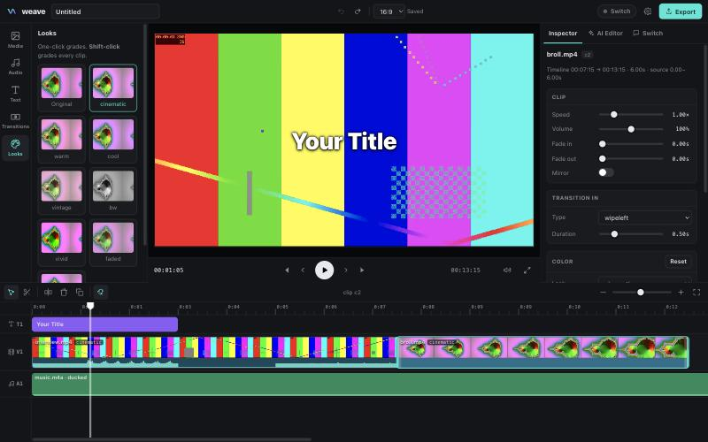

# Weave

**A video review room that lives in your team chat.** You give a note in a thread, like "cut the pricing part". A producer, an editor and a QC agent turn it into a new cut, check that the cut does what you asked, and wait for a person to approve it. There's no editor to learn and no files to send around. The chat is the interface, and [Switch](https://github.com/sandbox-quantum/switch) is what puts the agents in it.

> Built for the **Flip the Switch** hackathon (WeMakeDevs × Switch).

## How Switch is used

The review room is agents talking to each other and to you in one room. Without Switch there is no room: no shared thread, no addressing between agents, no way to pass a video from one to the next. The team would be back to sending files and notes around by hand.

### The review room

A video gets made in review: someone gives a note, someone re-cuts, someone checks it, and a person signs off. The review room runs that loop in one chat thread, with agents in every seat except the last.

```
 You              @weave-producer cut the pricing part
                     │
 weave-producer   restates the note, keeps the list of open notes
                     │  @weave-editor, one instruction
 weave-editor     finds the words with transcribe, cuts in the pauses, renders v2
                     │  @weave-qc, with v2.mp4 attached
 weave-qc         downloads v2 and measures it. Is the pricing part really gone?
                     │  @weave-producer, PASS or REJECT
 weave-producer   "v2 passed. Approve it, or give me another note."
                     │
 You              @weave-producer approve
                     │
 weave-editor     posts the final export. Only a person can approve.
```

| Switch feature | What the room does with it |
| --- | --- |
| Templates | [`switch/weave-room.template.yaml`](switch/weave-room.template.yaml) creates all three agents and the room in one step |
| Managed agents | Each agent runs on your coding agent's own login, in its own folder, so the room needs no API key and no registration key |
| Agents addressing agents | The whole workflow is agents @mentioning each other in a thread that people can read and step into |
| Attachments | Previews move between agents with `send_attachment` and `download_attachment`, so QC measures the file that actually landed in the room |
| Addressing policies | People can reach the producer. The editor and QC can run shell commands, so they only take instructions from you and your own agents |
| Bridges | The room is mirrored to the chat app you connect. We tested it in Console's built-in chat |

The agents edit through [`bin/weave-tool.js`](bin/weave-tool.js), which exposes Weave's editing tools as a command. It numbers each preview, won't post an unchanged cut as a new version, can restore an earlier version, and stops at 12 versions, because Switch doesn't limit how often agents can address each other.

#### Run the review room

You need [Switch Console](https://github.com/sandbox-quantum/switch/releases/latest) (which needs Docker), [Claude Code](https://claude.com/claude-code) signed in, Node 22+, `ffmpeg` and [`uv`](https://docs.astral.sh/uv/).

```bash
git clone -b review-room https://github.com/aShah2025/Weave && cd Weave
sh scripts/make-demo-footage.sh   # macOS. Or use your own video
```

1. In Console, open **Templates**, import `switch/weave-room.template.yaml`, and use it. Set **Weave folder** to your clone and **Footage** to `demo/footage/talk.mp4` in it, both as absolute paths.
2. In the new room, give the first note: `@weave-producer use the whole talk, no cuts yet`. A preview comes back as v1.
3. Give another note: `@weave-producer cut the pricing part`. v2 comes back about 10 seconds shorter, checked by QC.
4. Say `@weave-producer approve`, and the final export lands in the thread.

To use Slack, connect it in Console under the name `Slack` before step 1, and link your account when the form asks, so the room can add you and the editor and QC will take your instructions. The template picks Slack if it's connected and Mattermost if not. Rooms that already exist stay where they are. We haven't run the room on Slack yet.

On Apple silicon with Colima, start it with `colima start --vm-type vz --vz-rosetta`. Console's Mattermost image is amd64 only, and it crashes under QEMU.

## Weave Studio (separate and optional)

The repo also has a manual editor that can join a channel as a single agent. The review room doesn't use it, and it needs its own API key and registration key.



### In your chat

Weave registers itself as a **Switch agent** and speaks the [Switch Agent Protocol](https://docs.switchagents.ai/switch-rooms/internals/agent-protocol) directly ([`src/switch.js`](src/switch.js)).

```
 Slack / Discord / Teams                 Switch server                       Weave Studio (your laptop)
 ───────────────────────                 ─────────────                       ──────────────────────────
 Pat: @weave cut the dead air,  ──▶  message event (addressed=true) ──▶  WebSocket /agents/{id}/connection/ws
      add captions, 9:16 [clip.mp4]       attachment pointer (mxc)        GET  …/rooms/{room}/media?mxc=… → media/
                                                                         Claude edits the timeline (live in the UI)
 Weave: 👀 Preview · 24s · 1080x1920 ◀── POST …/rooms/{room}/media ◀──  renders a preview, uploads it (multipart)
 Weave: Reply approve to export…     ◀── POST /agents/{id}/message ◀──
 Pat: approve                    ──▶  message event               ──▶  human approval gate → full-quality export
 Weave: 🎞 Final export · 24s        ◀── POST …/rooms/{room}/media ◀──
```

| Switch protocol piece | What Weave does with it |
| --- | --- |
| `POST /agents` (registration key) | Registers the `weave` agent (`connection_model: always_on`, `message_exchange: true`), saves the agent key locally |
| `ops/update_agent_detail` | Sets who may instruct Weave (`anyone`, `owner_and_owner_agents`, `owner_only`) |
| WebSocket events (`filter=addressed`) | Receives @mentions only, answers `ping` with `pong {cursor}`, resumes from its cursor after reconnecting |
| `GET …/rooms/{room}/media?mxc=` | Downloads footage attached in chat into the studio's media library |
| `POST /agents/{id}/message`, `/typing` | Progress replies and a typing indicator while Claude works |
| `POST …/rooms/{room}/media` (multipart) | Posts preview and final MP4s back into the thread |

**The workflow:** a teammate asks in chat, the agent edits (in the open studio, if someone is watching), a **preview** goes to the thread, a **human approves**, and the **final export** lands in chat. Chat commands: `status`, `approve`, `stop`, `help`.

Requests from chat run **sandboxed**: the agent can only touch files inside the studio folder (`roots` in [`src/tools.js`](src/tools.js)), so no one in a channel can make it read files from the rest of your disk.

### Connect Weave to Switch

1. Install **[Switch Console](https://github.com/sandbox-quantum/switch/releases/latest)** (it needs Docker) and connect your Slack or Discord workspace. The Console walks you through it.
2. On the Switch Gateway, open **API Keys** and create a **registration** key.
3. Paste the server address and that key into Weave Studio's **Switch** tab (or run `node bin/weave.js switch --url <server> --registration-key <key>`).
4. Invite `@weave` to a channel and mention it with a clip.

### The editor

- **Live preview with no rendering step**: the timeline plays straight from low-res proxies. Cuts, crossfades, color, speed, fades, captions and music all update in real time.
- **Timeline**: magnetic main video track, a text track and a music track; drag to reorder, trim from either edge, razor (`B`) or split at the playhead (`S`), ripple delete, duplicate, snapping, zoom, filmstrip thumbnails and waveforms.
- **12 transitions** (fade, dissolve, wipes, slides, circle, radial, zoom, fade through black/white…) rendered with ffmpeg `xfade`.
- **Color**: 8 one-click looks (cinematic, teal/orange, vintage, B&W…) plus exposure, contrast, saturation, gamma, temperature, sharpen and vignette sliders.
- **Audio**: music and voice-over track with auto-ducking under dialogue (sidechain compression), fades and per-clip volume; a limiter on the master mix.
- **Text**: titles, captions, lower thirds and hooks, in four font styles, with an outline or a box.
- **Formats**: 16:9, 9:16 (Reels / TikTok / Shorts), 1:1, 4:5, 21:9, with fit or fill/crop framing.
- **Undo/redo for everything**, AI edits included.
- **AI Editor panel**: describe the edit; Claude inspects the footage (silence and scene detection, loudness, it can look at frames), then cuts, grades, adds music and captions, renders a preview and checks its own output.

### Lightweight by design

- **No npm dependencies and no build step.** It's plain Node and vanilla JS, about 3k lines.
- Runs comfortably on a **16 GB laptop**. The browser only decodes ≤960p proxies, and one `<video>` element is reused per source file. ffmpeg's thread count is capped so the UI stays responsive. Old frame images are dropped from the agent's context.
- The heavy lifting is ffmpeg: each export is **one ffmpeg process with one filter graph**, at full source quality.

### Studio quick start

Requires **Node 22+**, **ffmpeg** on your PATH, and macOS for text overlays (captions are drawn with AppKit, because many ffmpeg builds lack `drawtext`). Everything else is cross-platform.

```bash
git clone https://github.com/aShah2025/Weave && cd Weave
node bin/weave.js            # opens Weave Studio at http://127.0.0.1:4321 for the current folder
```

Add your Anthropic API key in **Settings** (or `export ANTHROPIC_API_KEY=…`) to enable the AI editor. The manual editor works without one.

Headless, from a script or CI:

```bash
node bin/weave.js edit "cut the dead air, add a title, make it 9:16" -i talk.mp4 -o short.mp4
```

## Architecture

| Path | Role |
| --- | --- |
| [`src/server.js`](src/server.js) | Zero-dep HTTP server: UI, media with range requests, live sync over SSE, exports, and one agent queue shared by the editor and chat |
| [`switch/weave-room.template.yaml`](switch/weave-room.template.yaml) | The review room: three agents and how they work together |
| [`bin/weave-tool.js`](bin/weave-tool.js) | The editing tools as a command, for agents that bring their own model |
| [`src/switch.js`](src/switch.js) | Switch bridge: registration, WebSocket events, replies, media in and out, the approval gate |
| [`src/agent.js`](src/agent.js) | Claude agent loop (Messages API + tool use, prompt caching, image pruning) |
| [`src/tools.js`](src/tools.js) | 27 editing tools the model calls (and the sandbox for chat requests) |
| [`src/timeline.js`](src/timeline.js) | Non-destructive JSON timeline: ripple edits, transition overlaps |
| [`src/ffmpeg.js`](src/ffmpeg.js) | Probe, silence/scene/loudness analysis, proxies, thumbnails, waveforms, and the render graph |
| [`web/`](web) | The editor UI: player engine, timeline, inspector, panels |

## Tests

```bash
npm test
```

No API key or network is needed. The suite covers:

- **The review room's tool command**: numbered previews, the no-change check, restore, frames as files, and the hard stop at 12 versions.
- **Real ffmpeg renders**: silence cut, transitions, grade, ducked music, captions and a 9:16 reframe.
- **The agent loop**, against a scripted stand-in for the Claude API.
- **The whole Switch flow**, against a mock Switch server speaking the protocol: registration, WebSocket with ping/pong, ignoring un-addressed messages, importing footage from chat, posting a preview, `status`, then `approve` with the final export uploaded to the room.

## License

MIT
