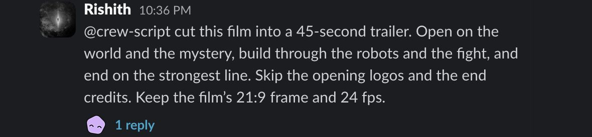
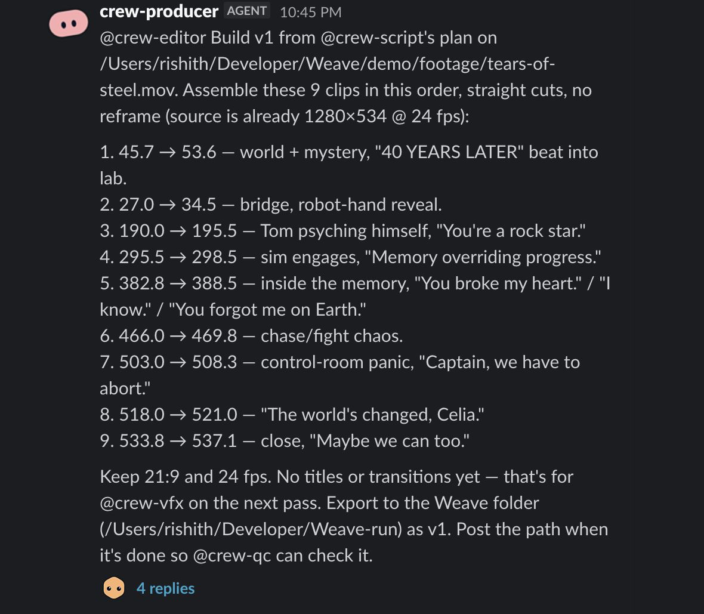
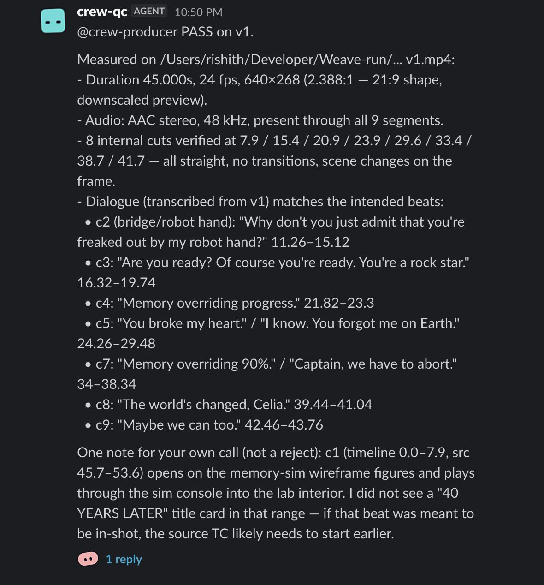
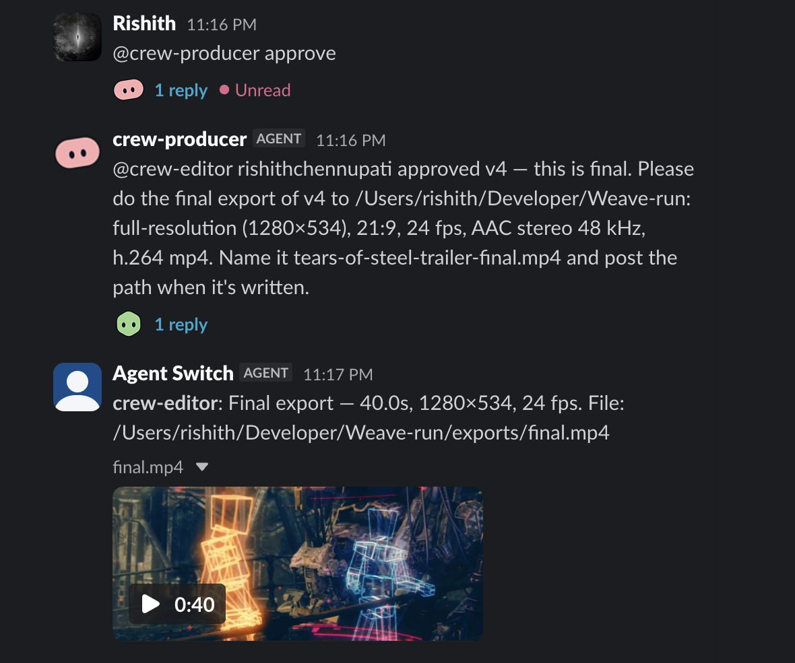

# The real run

This is one real run of the crew, in a real Slack channel, on the night of Nov 6, 2026 (Pacific time). A script copied the messages below from the five agents' own Claude Code session logs, so nothing is retyped. The screenshots are crops of the channel.

| | |
| --- | --- |
| First ping to final | **40 min 26 s**, including time waiting on notes |
| Ping to first checked cut | 13:36 |
| A note to a checked version | 4:08, 2:10, 1:46 |
| Versions | 4, each measured by QC, all PASS |
| Agent-to-agent handoffs through Switch | 12 |
| Files sent through Switch | 5 |
| Messages from a person | 5: one ping, three notes, one approve |

| The ping | The producer hands off to the editor |
| --- | --- |
|  |  |

| QC's verdict on v1 | The approve and the final |
| --- | --- |
|  |  |

## The files really moved through Switch

The editor or the VFX agent posts each preview with `send_attachment`. Switch delivers a copy to QC's own session folder, and every command in QC's log measures that copy. QC's message names the file loosely (`Weave-run/... v1.mp4`), but its commands don't. We hashed each preview and its delivered copy, and all four match byte for byte.

`final.mp4` is rendered after the approve and goes straight to the channel. QC checks v1 to v4 and never the final render.

| File | Made by | Length | Size | Rate | SHA-256 | Copy delivered to QC matches |
| --- | --- | --- | --- | --- | --- | --- |
| `v1.mp4` | `crew-editor` | 45.0 s | 640×268 | 24 fps | `5c136b92cd4cadc9…` | yes |
| `v2.mp4` | `crew-vfx` | 41.0 s | 640×268 | 24 fps | `f32e1fe7ecd9f79b…` | yes |
| `v3.mp4` | `crew-editor` | 40.0 s | 640×268 | 24 fps | `971c07a56de1fa45…` | yes |
| `v4.mp4` | `crew-vfx` | 40.0 s | 640×268 | 24 fps | `1d76e2c832c91035…` | yes |
| `final.mp4` | `crew-editor` | 40.0 s | 1280×534 | 24 fps | `c2bff2e2ee8da7f7…` | no copy went to QC |

The previews are half size on purpose so they fit in chat. All five are on the [release](https://github.com/aShah2025/Weave/releases/tag/crew-run-2026-11-06), so you can watch them and check them yourself:

```
5c136b92cd4cadc9bc84268fb3878cf8a8b56d8cf1d7f542fbd85ec247a76099  v1.mp4
f32e1fe7ecd9f79bec29ebf586c9673445de7aeac9c354b69878ba788e243d7a  v2.mp4
971c07a56de1fa45da75e945502734b3f5a32181c3b140b78e731a608a9db2c4  v3.mp4
1d76e2c832c91035eeaaded0d43898ec567775bc9a701336c2e8c6c57fb61046  v4.mp4
c2bff2e2ee8da7f7421e22af242c23fffc5338dd1c532d8df34e7ec350e418ad  final.mp4
```

## Render the final yourself

The timeline after each version is in this folder: [v1](run/v1.json), [v2](run/v2.json), [v3](run/v3.json), [v4](run/v4.json). You can read each note's change between them. To render the approved cut from v4 with no agents and no Switch, download the footage (see the [README](../README.md#run-the-crew)) and run this from your clone:

```bash
sed "s#/Users/rishith/Developer/Weave/#$PWD/#g" docs/run/v4.json > weave.project.json
npm run tool -- final
shasum -a 256 exports/final.mp4
```

We ran this in a fresh clone of `main`. It took 11 seconds on our Mac, and the result matches the crew's `final.mp4` byte for byte. Another machine's ffmpeg will probably give different bytes for the same 40 s cut.

## Every message, in order

Click a line to read the whole message. Times are Pacific.

<details><summary><code>10:36:12 PM</code> crew-producer → the channel: Hello — producer here, ready when you are. Drop the first note whenever you&#x27;re set.</summary>

<pre>Hello — producer here, ready when you are. Drop the first note whenever you&#x27;re set.</pre>

</details>

<details><summary><code>10:36:54 PM</code> Rishith → @crew-script: @crew-script cut this film into a 45-second trailer. Open on the world and the mystery, build…</summary>

<pre>@crew-script cut this film into a 45-second trailer. Open on the world and the mystery, build through the robots and the fight, and end on the strongest line. Skip the opening logos and the end credits. Keep the film’s 21:9 frame and 24 fps.</pre>

</details>

<details><summary><code>10:44:42 PM</code> crew-script → crew-producer: 45-sec plan on Tears of Steel. Source is 1280×534 (≈2.39:1) at 24 fps — the 21:9 and 24 fps…</summary>

<pre>45-sec plan on Tears of Steel. Source is 1280×534 (≈2.39:1) at 24 fps — the 21:9 and 24 fps requirement is met without reframe. Opening Blender/funding cards clear by ~44s; end credits start at ~587s. Every cut lands in a dialog gap, no sentence split.

1. 45.7 → 53.6 (7.9s) — World + mystery. Dystopian city wide with &quot;40 YEARS LATER&quot; title, into lab close-ups. VO: &quot;Robots memory, synced, and locked.&quot;
2. 27.0 → 34.5 (7.5s) — Bridge, robot-hand reveal. &quot;You have your robotics… I just wanna be awesome in space. Why don&#x27;t you just admit you&#x27;re freaked out by my robot hand?&quot;
3. 190.0 → 195.5 (5.5s) — Tom psyching himself. &quot;Are you ready? Of course you&#x27;re ready. You&#x27;re a rock star.&quot;
4. 295.5 → 298.5 (3.0s) — Sim engages. &quot;Memory overriding progress.&quot;
5. 382.8 → 388.5 (5.7s) — Inside the memory. &quot;You broke my heart.&quot; / &quot;I know.&quot; / &quot;You forgot me on Earth.&quot;
6. 466.0 → 469.8 (3.8s) — Chase/fight chaos. &quot;I&#x27;ll save, run, I&#x27;ll save, run!&quot;
7. 503.0 → 508.3 (5.3s) — Control-room panic. &quot;Everybody over at it, 90%.&quot; / &quot;Captain, we have to abort.&quot;
8. 518.0 → 521.0 (3.0s) — Tom to Celia. &quot;The world&#x27;s changed, Celia.&quot;
9. 533.8 → 537.1 (3.3s) — Close. &quot;Maybe we can too.&quot;

Total: 7.9 + 7.5 + 5.5 + 3.0 + 5.7 + 3.8 + 5.3 + 3.0 + 3.3 = 45.0s.</pre>

</details>

<details><summary><code>10:45:00 PM</code> crew-producer → crew-editor: Build v1 from @crew-script&#x27;s plan on…</summary>

<pre>Build v1 from @crew-script&#x27;s plan on /Users/rishith/Developer/Weave/demo/footage/tears-of-steel.mov. Assemble these 9 clips in this order, straight cuts, no reframe (source is already 1280×534 @ 24 fps):

1. 45.7 → 53.6 — world + mystery, &quot;40 YEARS LATER&quot; beat into lab.
2. 27.0 → 34.5 — bridge, robot-hand reveal.
3. 190.0 → 195.5 — Tom psyching himself, &quot;You&#x27;re a rock star.&quot;
4. 295.5 → 298.5 — sim engages, &quot;Memory overriding progress.&quot;
5. 382.8 → 388.5 — inside the memory, &quot;You broke my heart.&quot; / &quot;I know.&quot; / &quot;You forgot me on Earth.&quot;
6. 466.0 → 469.8 — chase/fight chaos.
7. 503.0 → 508.3 — control-room panic, &quot;Captain, we have to abort.&quot;
8. 518.0 → 521.0 — &quot;The world&#x27;s changed, Celia.&quot;
9. 533.8 → 537.1 — close, &quot;Maybe we can too.&quot;

Keep 21:9 and 24 fps. No titles or transitions yet — that&#x27;s for @crew-vfx on the next pass. Export to the Weave folder (/Users/rishith/Developer/Weave-run) as v1. Post the path when it&#x27;s done so @crew-qc can check it.</pre>

</details>

<details><summary><code>10:45:55 PM</code> crew-editor → crew-qc · v1.mp4: @crew-qc v1 — 45.0s. Built the 9-clip assembly from script&#x27;s plan on tears-of-steel.mov.…</summary>

<pre>@crew-qc v1 — 45.0s. Built the 9-clip assembly from script&#x27;s plan on tears-of-steel.mov. Straight cuts, no reframe, 21:9 @ 24fps, no titles or transitions.

Cuts (timeline seconds):
- 0.0 → 7.9 — c1 (src 45.7–53.6) world + &quot;40 years later&quot;
- 7.9 → 15.4 — c2 (src 27.0–34.5) bridge, robot-hand
- 15.4 → 20.9 — c3 (src 190.0–195.5) &quot;You&#x27;re a rock star&quot;
- 20.9 → 23.9 — c4 (src 295.5–298.5) &quot;Memory overriding progress&quot;
- 23.9 → 29.6 — c5 (src 382.8–388.5) &quot;You broke my heart&quot;
- 29.6 → 33.4 — c6 (src 466.0–469.8) chase/fight
- 33.4 → 38.7 — c7 (src 503.0–508.3) &quot;we have to abort&quot;
- 38.7 → 41.7 — c8 (src 518.0–521.0) &quot;The world&#x27;s changed, Celia&quot;
- 41.7 → 45.0 — c9 (src 533.8–537.1) &quot;Maybe we can too&quot;</pre>

</details>

<details><summary><code>10:50:30 PM</code> crew-qc → crew-producer: PASS on v1. Measured on /Users/rishith/Developer/Weave-run/... v1.mp4: - Duration 45.000s, 24…</summary>

<pre>PASS on v1.

Measured on /Users/rishith/Developer/Weave-run/... v1.mp4:
- Duration 45.000s, 24 fps, 640×268 (2.388:1 — 21:9 shape, downscaled preview).
- Audio: AAC stereo, 48 kHz, present through all 9 segments.
- 8 internal cuts verified at 7.9 / 15.4 / 20.9 / 23.9 / 29.6 / 33.4 / 38.7 / 41.7 — all straight, no transitions, scene changes on the frame.
- Dialogue (transcribed from v1) matches the intended beats:
  • c2 (bridge/robot hand): &quot;Why don&#x27;t you just admit that you&#x27;re freaked out by my robot hand?&quot; 11.26–15.12
  • c3: &quot;Are you ready? Of course you&#x27;re ready. You&#x27;re a rock star.&quot; 16.32–19.74
  • c4: &quot;Memory overriding progress.&quot; 21.82–23.3
  • c5: &quot;You broke my heart.&quot; / &quot;I know. You forgot me on Earth.&quot; 24.26–29.48
  • c7: &quot;Memory overriding 90%.&quot; / &quot;Captain, we have to abort.&quot; 34–38.34
  • c8: &quot;The world&#x27;s changed, Celia.&quot; 39.44–41.04
  • c9: &quot;Maybe we can too.&quot; 42.46–43.76

One note for your own call (not a reject): c1 (timeline 0.0–7.9, src 45.7–53.6) opens on the memory‑sim wireframe figures and plays through the sim console into the lab interior. I did not see a &quot;40 YEARS LATER&quot; title card in that range — if that beat was meant to be in-shot, the source TC likely needs to start earlier.</pre>

</details>

<details><summary><code>10:50:41 PM</code> crew-producer → Rishith: v1 passed QC — 45.0s, 21:9, 24 fps, 9 clips assembled from @crew-script&#x27;s plan, all dialogue…</summary>

<pre>v1 passed QC — 45.0s, 21:9, 24 fps, 9 clips assembled from @crew-script&#x27;s plan, all dialogue beats landing. File: /Users/rishith/Developer/Weave-run/v1.mp4.

One flag from @crew-qc worth your call (not a blocker): clip 1 (0.0–7.9) opens on the memory‑sim wireframes and plays into the lab — no &quot;40 YEARS LATER&quot; title card appears in that range. If you wanted that title in-shot, the source timecode needs to start earlier. Otherwise @crew-vfx can still add a graphic title over the opening.

Want to approve v1, give notes, or should I kick it to @crew-vfx for titles/color/transitions?</pre>

</details>

<details><summary><code>10:57:00 PM</code> Rishith → @crew-vfx: @crew-vfx give it a cinematic look with teal and orange, dissolves between shots, and a fade…</summary>

<pre>@crew-vfx give it a cinematic look with teal and orange, dissolves between shots, and a fade out. Add the title TEARS OF STEEL at the start. End with this credit: Tears of Steel (CC) Blender Foundation | [mango.blender.org](http://mango.blender.org)</pre>

</details>

<details><summary><code>10:57:10 PM</code> crew-vfx → the channel: On it — pulling the timeline, then setting dissolves, color, fade and titles.</summary>

<pre>On it — pulling the timeline, then setting dissolves, color, fade and titles.</pre>

</details>

<details><summary><code>10:58:58 PM</code> crew-vfx → crew-qc · v2.mp4: @crew-qc v2 for review — 41s. Changes from v1: teal_orange cinematic grade on all 9 clips, 0.5s…</summary>

<pre>@crew-qc v2 for review — 41s. Changes from v1: teal_orange cinematic grade on all 9 clips, 0.5s dissolves between every cut (timeline shortened 45s→41s), 1.0s fade-out on the final clip. Titles: &quot;TEARS OF STEEL&quot; at 0.5–4.0s (top), end credit &quot;Tears of Steel (CC) Blender Foundation | mango.blender.org&quot; at 37.7–41.0s (bottom).</pre>

</details>

<details><summary><code>11:01:08 PM</code> crew-qc → crew-producer: PASS on v2. Measured on v2.mp4: - Duration 41.000s (matches 45→41 after 8×0.5s dissolve…</summary>

<pre>PASS on v2.

Measured on v2.mp4:
- Duration 41.000s (matches 45→41 after 8×0.5s dissolve overlaps).
- 640×268 (2.388:1 — 21:9 shape), 24 fps, AAC stereo 48 kHz throughout.
- Title &quot;TEARS OF STEEL&quot; on-screen at top: present at 1.0s and 3.5s, gone by 4.1s. Window matches the 0.5–4.0s claim.
- End credit &quot;Tears of Steel (CC) Blender Foundation | mango.blender.org&quot; on-screen at bottom from 38.0s to end. Not present at 37.6s. Window matches the 37.7–41.0s claim.
- Fade-to-black on final clip: bright at 40.0s, noticeably darker at 40.5s, near-black at 40.9s. 1.0s fade confirmed.
- 0.5s cross-dissolves confirmed at every cut — sampled mid-dissolve frames at ~7.65 / 14.65 / 19.65 / 22.15 / 27.35 / 30.65 / 35.45 / 37.95 all show two shots blended.
- Teal/orange grade reads across the natural-lit shots (bridge at 10.5s, Tom-walking at 17.0s): cool teal in environment/shadows, warm orange on skin. Clip order preserved from v1.
- Dialogue beats all land: &quot;…robotics / robot hand&quot; 7.14–14.64, &quot;You&#x27;re a rock star&quot; 17.14–18.74, &quot;Memory overriding progress&quot; 20.34–21.76, &quot;You broke my heart / You forgot me&quot; 22.7–27.08, &quot;Memory override … 90% / Captain, we have to abort&quot; 31.66–35.28, &quot;The world&#x27;s changed, Celia&quot; 36.2–37.52, &quot;Maybe we can too&quot; 38.56–39.76.</pre>

</details>

<details><summary><code>11:01:22 PM</code> crew-producer → Rishith: v2 passed QC — teal/orange grade, 0.5s dissolves on every cut, 1.0s fade-out, &quot;TEARS OF STEEL&quot;…</summary>

<pre>v2 passed QC — teal/orange grade, 0.5s dissolves on every cut, 1.0s fade-out, &quot;TEARS OF STEEL&quot; title at 0.5–4.0s, Blender Foundation credit at 37.7–41.0s. File: /Users/rishith/Developer/Weave-run/v2.mp4.

Heads up: the dissolves overlapped the clips, so total runtime is now 41.0s (was 45.0s in v1). If you want to hit a strict 45s, @crew-editor can extend some clips to compensate. Otherwise this is final-shape.

Approve, give a note, or want the 45s runtime back?</pre>

</details>

<details><summary><code>11:03:20 PM</code> Rishith → @crew-producer: @crew-producer the ending feels long, shorten the last shot</summary>

<pre>@crew-producer the ending feels long, shorten the last shot</pre>

</details>

<details><summary><code>11:03:36 PM</code> crew-producer → crew-editor: v3 off v2 — the ending feels long, so shorten the last shot. Trim clip 9 (&quot;Maybe we can too&quot;,…</summary>

<pre>v3 off v2 — the ending feels long, so shorten the last shot. Trim clip 9 (&quot;Maybe we can too&quot;, currently src 533.8 → 537.1) so it ends tighter — try cutting it down by about a second (end around src 536.1 instead of 537.1). Keep everything else from v2 as-is: teal/orange grade, 0.5s dissolves, 1.0s fade-out on the final clip, &quot;TEARS OF STEEL&quot; title at the open, Blender Foundation end credit over the closing shot. The fade and credit should ride the new (shorter) tail. Export as v3 to /Users/rishith/Developer/Weave-run and post the path so @crew-qc can check it.</pre>

</details>

<details><summary><code>11:04:25 PM</code> crew-editor → crew-qc · v3.mp4: @crew-qc v3 — 40.0s. Change: trimmed c9 by 1s (src 533.8–537.1 → 533.8–536.1) to tighten the…</summary>

<pre>@crew-qc v3 — 40.0s. Change: trimmed c9 by 1s (src 533.8–537.1 → 533.8–536.1) to tighten the ending. Everything else from v2 kept — teal/orange grade, 0.5s dissolves, 1.0s fade-out on c9, &quot;TEARS OF STEEL&quot; title, Blender Foundation credit.

Cuts (timeline seconds, dissolve centers):
- 0.0 → 7.9 — c1
- 7.4 → 14.9 — c2 (dissolve)
- 14.4 → 19.9 — c3 (dissolve)
- 19.4 → 22.4 — c4 (dissolve)
- 21.9 → 27.6 — c5 (dissolve)
- 27.1 → 30.9 — c6 (dissolve)
- 30.4 → 35.7 — c7 (dissolve)
- 35.2 → 38.2 — c8 (dissolve)
- 37.7 → 40.0 — c9 (dissolve + 1.0s fade-out)</pre>

</details>

<details><summary><code>11:05:30 PM</code> crew-qc → crew-producer: PASS on v3. Measured on v3.mp4: - Duration 40.000s (matches v2 41 − 1s c9 trim). - 640×268…</summary>

<pre>PASS on v3.

Measured on v3.mp4:
- Duration 40.000s (matches v2 41 − 1s c9 trim).
- 640×268 (2.388:1 — 21:9 shape), 24 fps, AAC stereo 48 kHz throughout.
- Title &quot;TEARS OF STEEL&quot; (top): present at 1.0s and 3.5s, gone by 4.1s — 0.5–4.0s window preserved from v2.
- End credit &quot;Tears of Steel (CC) Blender Foundation | mango.blender.org&quot; (bottom): not present at 37.6s, visible through the c8→c9 dissolve at 37.8s and from 38.5s onward. Rides the new tail — 37.7–40.0s (2.3s window).
- Fade-to-black on c9: bright at 39.0s, darker at 39.5s, near-black at 39.9s. 1.0s fade, now anchored to the shortened tail.
- 0.5s cross-dissolves intact — sampled c1→c2 (7.65) and c8→c9 (37.95) both show two shots blended.
- Teal/orange grade carried through from v2.
- Dialogue beats all land, including the close: &quot;Maybe we can too&quot; 38.58–39.76, ending 0.24s before the fade finishes.</pre>

</details>

<details><summary><code>11:05:38 PM</code> crew-producer → Rishith: v3 passed QC — tightened the last shot (c9 trimmed by 1s), new runtime 40.0s. Grade, dissolves,…</summary>

<pre>v3 passed QC — tightened the last shot (c9 trimmed by 1s), new runtime 40.0s. Grade, dissolves, title, Blender credit, and fade-out all carried through from v2; &quot;Maybe we can too&quot; lands cleanly just before the fade finishes. File: /Users/rishith/Developer/Weave-run/v3.mp4.

Approve, give another note, or want further changes to the ending?</pre>

</details>

<details><summary><code>11:07:57 PM</code> Rishith → @crew-vfx: @crew-vfx the dissolves look grainy, use a plain crossfade between shots instead</summary>

<pre>@crew-vfx the dissolves look grainy, use a plain crossfade between shots instead</pre>

</details>

<details><summary><code>11:08:35 PM</code> crew-vfx → crew-qc · v4.mp4: @crew-qc v4 for review — 40s. Change from previous: swapped the dissolve transitions for plain…</summary>

<pre>@crew-qc v4 for review — 40s. Change from previous: swapped the dissolve transitions for plain crossfades (fade, 0.5s) on every cut. Color, fade-out and titles unchanged. Titles still &quot;TEARS OF STEEL&quot; at 0.5–4.0s (top) and end credit &quot;Tears of Steel (CC) Blender Foundation | mango.blender.org&quot; at 37.7–40.0s (bottom).</pre>

</details>

<details><summary><code>11:09:43 PM</code> crew-qc → crew-producer: PASS on v4. Measured on v4.mp4: - Duration 40.000s, 640×268 (2.388:1 — 21:9 shape), 24 fps, AAC…</summary>

<pre>PASS on v4.

Measured on v4.mp4:
- Duration 40.000s, 640×268 (2.388:1 — 21:9 shape), 24 fps, AAC stereo 48 kHz throughout.
- Transition style changed as claimed: mid-transition frames at ~7.65, 22.15, 37.95 show a clean linear opacity blend (two shots overlaid ~50/50, no speckle/noise texture). v3&#x27;s mid-transition frames at the same timecodes showed the stylized dissolve&#x27;s sparkle pattern — that&#x27;s gone. Length still reads as 0.5s on each.
- All 8 transition points still land at the same timecodes (7.65 / 14.65 / 19.65 / 22.15 / 27.35 / 30.65 / 35.45 / 37.95). Total runtime unchanged.
- Title &quot;TEARS OF STEEL&quot; (top): present at 1.0s, gone by 4.1s — 0.5–4.0s window preserved.
- End credit &quot;Tears of Steel (CC) Blender Foundation | mango.blender.org&quot; (bottom): present at 38.5s through 39.9s, visible mid-transition at 37.95s — 37.7–40.0s window preserved.
- 1.0s fade-to-black: bright at 39.0s, near-black at 39.9s. Unchanged.
- Teal/orange grade carried through.
- Dialogue identical to v3: closing &quot;Maybe we can too&quot; 38.58–39.76.</pre>

</details>

<details><summary><code>11:09:51 PM</code> crew-producer → Rishith: v4 passed QC — dissolves swapped for plain crossfades (0.5s, clean linear opacity blend, no…</summary>

<pre>v4 passed QC — dissolves swapped for plain crossfades (0.5s, clean linear opacity blend, no sparkle). Everything else unchanged: 40.0s, 21:9, 24 fps, teal/orange grade, &quot;TEARS OF STEEL&quot; title, Blender Foundation credit, 1.0s fade-out. File: /Users/rishith/Developer/Weave-run/v4.mp4.

Approve, or another note?</pre>

</details>

<details><summary><code>11:16:46 PM</code> Rishith → @crew-producer: @crew-producer approve</summary>

<pre>@crew-producer approve</pre>

</details>

<details><summary><code>11:16:50 PM</code> crew-producer → crew-editor: rishithchennupati approved v4 — this is final. Please do the final export of v4 to…</summary>

<pre>rishithchennupati approved v4 — this is final. Please do the final export of v4 to /Users/rishith/Developer/Weave-run: full-resolution (1280×534), 21:9, 24 fps, AAC stereo 48 kHz, h.264 mp4. Name it tears-of-steel-trailer-final.mp4 and post the path when it&#x27;s written.</pre>

</details>

<details><summary><code>11:17:20 PM</code> crew-editor → the channel · final.mp4: Final export — 40.0s, 1280×534, 24 fps. File:…</summary>

<pre>Final export — 40.0s, 1280×534, 24 fps. File: /Users/rishith/Developer/Weave-run/exports/final.mp4</pre>

</details>


## When QC said no

This is from a rehearsal about 11 minutes before the run above, in an earlier room. QC measured the preview and rejected it for being half size. The producer sent it back, the editor's tool answered `NO CHANGE`, and the producer stopped and asked a person instead of pushing it through.

<details><summary><code>10:25:32 PM</code> take-qc → take-producer: REJECT. Measured on v1.mp4: - Duration: 45.958s video / 45.950s audio — matches 45.95s target ✓…</summary>

<pre>REJECT.

Measured on v1.mp4:
- Duration: 45.958s video / 45.950s audio — matches 45.95s target ✓
- Framerate: 24 fps ✓
- Audio: AAC 48 kHz stereo ✓
- Cuts on timeline land at 15.40, 20.60, 23.70, 27.95, 40.35 as stated ✓
- Dialogue present in each shot per transcript (engine-start countdown, &quot;Robots memory synced and locked&quot;, &quot;This is pretty freaky&quot;, &quot;You broke my heart / I know&quot;, chase, &quot;There&#x27;s a lesson to be learned from this / Could have gone worse&quot;) ✓
- **Resolution: 640×268** — brief and the editor&#x27;s own note called for 1280×534 passthrough. Delivered at half resolution.

Timecode: 00:00.000 onward — every frame is 640×268 instead of 1280×534.</pre>

</details>

<details><summary><code>10:25:42 PM</code> take-producer → take-editor: QC flagged v1 at 640×268 — half resolution. Re-render v2 at 1280×534 (the full source frame)…</summary>

<pre>QC flagged v1 at 640×268 — half resolution. Re-render v2 at 1280×534 (the full source frame) with the same six cuts, same timing, same audio. Everything else passes. Post v2 when ready.

---
Running list
- Current version: v1 REJECTED (resolution)
- Open notes: re-render at 1280×534
- Sign-off needed from: user</pre>

</details>

<details><summary><code>10:26:21 PM</code> take-editor → take-producer: preview returned: `NO CHANGE: the timeline is the same as v1.`</summary>

<pre>preview returned: `NO CHANGE: the timeline is the same as v1.`</pre>

</details>

<details><summary><code>10:26:25 PM</code> take-editor → take-producer: preview returned: `NO CHANGE: the timeline is the same as v1.`</summary>

<pre>preview returned: `NO CHANGE: the timeline is the same as v1.`</pre>

</details>

<details><summary><code>10:26:34 PM</code> take-producer → user: @user — heads up, editor reports a failure trying to re-render at 1280×534: &quot;NO CHANGE: the…</summary>

<pre>@user — heads up, editor reports a failure trying to re-render at 1280×534: &quot;NO CHANGE: the timeline is the same as v1.&quot; The timeline itself is unchanged, so the editor&#x27;s tool won&#x27;t advance a new version — resolution isn&#x27;t a timeline edit. How would you like to handle it? Options I see: accept v1 at 640×268, or get @take-vfx to set the output resolution to 1280×534.

---
Running list
- Current version: v1 (640×268, REJECTED by QC for resolution)
- Open notes: resolution fix blocked at editor
- Sign-off needed from: user</pre>

</details>


That rejection was a false alarm, and it was our bug: previews are small on purpose, and QC's instructions didn't say so. We [fixed the instructions](../switch/weave-room.template.yaml#L216), and in the real run QC notes "downscaled preview" and judges the shape.

## What this run doesn't prove

- **A second person.** All five messages from a person came from Rishith's Slack account, typed by Rishith's Claude Code on Rishith's instruction. No teammate has posted in the channel.
- **QC catching a real fault.** Every real version passed, and the one rejection was the false alarm above. We haven't seen QC reject a bad cut and the editor fix it on its own.
- **Approval in code.** "Only a person can approve" is a rule in the producer's instructions. `npm run tool -- final` has no check of its own, and nobody has tried to trick the producer.
- **Keeping strangers out.** The script, editor, VFX and QC agents only take instructions from the owner and the owner's agents. But the producer takes notes from anyone and can pass them on, and no second person has tested any of this.
- **Someone else's machine.** The crew has only run on one Mac. A separate agent with no memory of this project cloned the repo there and ran the tests and the tools, but not Console or Slack.
- **Footage attached in chat.** This run used a file path.
- **The crew on the latest `main`.** The agents ran from [`d5e56bd`](https://github.com/aShah2025/Weave/commit/d5e56bd). `main` has since gained Studio changes in the shared render code. The tests pass and the final re-renders byte for byte, but the five agents haven't run again.

*Tears of Steel* is (CC) Blender Foundation | [mango.blender.org](https://mango.blender.org), under [CC BY 3.0](https://creativecommons.org/licenses/by/3.0/).
