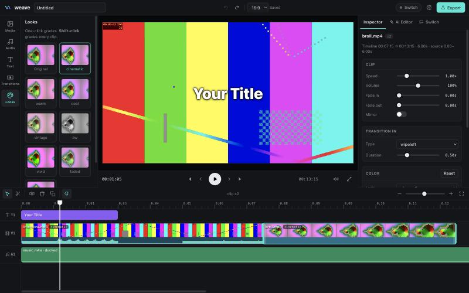

# Weave Studio

The repo also has a manual editor that can join a channel as a single agent. The crew doesn't use it, and it needs its own API key and registration key.



## In your chat

Weave registers itself as a **Switch agent** and speaks the [Switch Agent Protocol](https://docs.switchagents.ai/switch-rooms/internals/agent-protocol) directly ([`src/switch.js`](../src/switch.js)).

```
 Slack / Discord / Teams                 Switch server                       Weave Studio (your laptop)
 ───────────────────────                 ─────────────                       ──────────────────────────
 Pat: @weave cut the dead air,  ──▶  message event (addressed=true) ──▶  WebSocket /agents/{id}/connection/ws
      add captions, 9:16 [clip.mp4]       attachment pointer (mxc)        GET  …/rooms/{room}/media?mxc=… → media/
                                                                         Claude edits the timeline (live in the UI)
 Weave: 👀 Preview · 24s · 1080x1920 ◀── POST …/rooms/{room}/media ◀──  renders a preview, uploads it (multipart)
 Weave: Reply approve to export…     ◀── POST /agents/{id}/message ◀──
 Pat: approve                    ──▶  message event               ──▶  human approval gate → full-quality export
 Weave: 🎞 Final export · 24s        ◀── POST …/rooms/{room}/media ◀──
```

| Switch protocol piece | What Weave does with it |
| --- | --- |
| `POST /agents` (registration key) | Registers the `weave` agent (`connection_model: always_on`, `message_exchange: true`), saves the agent key locally |
| `ops/update_agent_detail` | Sets who may instruct Weave (`anyone`, `owner_and_owner_agents`, `owner_only`) |
| WebSocket events (`filter=addressed`) | Receives @mentions only, answers `ping` with `pong {cursor}`, resumes from its cursor after reconnecting |
| `GET …/rooms/{room}/media?mxc=` | Downloads footage attached in chat into the studio's media library |
| `POST /agents/{id}/message`, `/typing` | Progress replies and a typing indicator while Claude works |
| `POST …/rooms/{room}/media` (multipart) | Posts preview and final MP4s back into the thread |

**The workflow:** a teammate asks in chat, the agent edits (in the open studio, if someone is watching), a **preview** goes to the thread, a **human approves**, and the **final export** lands in chat. Chat commands: `status`, `approve`, `stop`, `help`.

Requests from chat run **sandboxed**: the agent can only touch files inside the studio folder (`roots` in [`src/tools.js`](../src/tools.js)), so no one in a channel can make it read files from the rest of your disk.

## Connect Weave to Switch

> Not re-checked on Console 0.40.1, which has no **API Keys** screen, so step 2 below may not work as written.

1. Install **[Switch Console](https://github.com/sandbox-quantum/switch/releases/latest)** (it needs Docker) and connect your Slack or Discord workspace. The Console walks you through it.
2. On the Switch Gateway, open **API Keys** and create a **registration** key.
3. Paste the server address and that key into Weave Studio's **Switch** tab (or run `node bin/weave.js switch --url <server> --registration-key <key>`).
4. Invite `@weave` to a channel and mention it with a clip.

## The editor

- **Live preview with no rendering step**: the timeline plays straight from low-res proxies. Cuts, crossfades, color, speed, fades, captions and music all update in real time.
- **Timeline**: magnetic main video track, a text track and a music track; drag to reorder, trim from either edge, razor (`B`) or split at the playhead (`S`), ripple delete, duplicate, snapping, zoom, filmstrip thumbnails and waveforms.
- **12 transitions** (fade, dissolve, wipes, slides, circle, radial, zoom, fade through black/white…) rendered with ffmpeg `xfade`.
- **Color**: 8 one-click looks (cinematic, teal/orange, vintage, B&W…) plus exposure, contrast, saturation, gamma, temperature, sharpen and vignette sliders.
- **Audio**: music and voice-over track with auto-ducking under dialogue (sidechain compression), fades and per-clip volume; a limiter on the master mix.
- **Text**: titles, captions, lower thirds and hooks, in four font styles, with an outline or a box.
- **Formats**: 16:9, 9:16 (Reels / TikTok / Shorts), 1:1, 4:5, 21:9, with fit or fill/crop framing.
- **Undo/redo for everything**, AI edits included.
- **AI Editor panel**: describe the edit; Claude inspects the footage (silence and scene detection, loudness, it can look at frames), then cuts, grades, adds music and captions, renders a preview and checks its own output.

## Lightweight by design

- **No npm dependencies and no build step.** It's plain Node and vanilla JS, about 3k lines.
- Runs comfortably on a **16 GB laptop**. The browser only decodes ≤960p proxies, and one `<video>` element is reused per source file. ffmpeg's thread count is capped so the UI stays responsive. Old frame images are dropped from the agent's context.
- The heavy lifting is ffmpeg: each export is **one ffmpeg process with one filter graph**, at full source quality.

## Studio quick start

Requires **Node 22+**, **ffmpeg** on your PATH, and macOS for text overlays (captions are drawn with AppKit, because many ffmpeg builds lack `drawtext`). Everything else is cross-platform.

```bash
git clone https://github.com/aShah2025/Weave && cd Weave
node bin/weave.js            # opens Weave Studio at http://127.0.0.1:4321 for the current folder
```

Add your Anthropic API key in **Settings** (or `export ANTHROPIC_API_KEY=…`) to enable the AI editor. The manual editor works without one.

Headless, from a script or CI:

```bash
node bin/weave.js edit "cut the dead air, add a title, make it 9:16" -i talk.mp4 -o short.mp4
```
